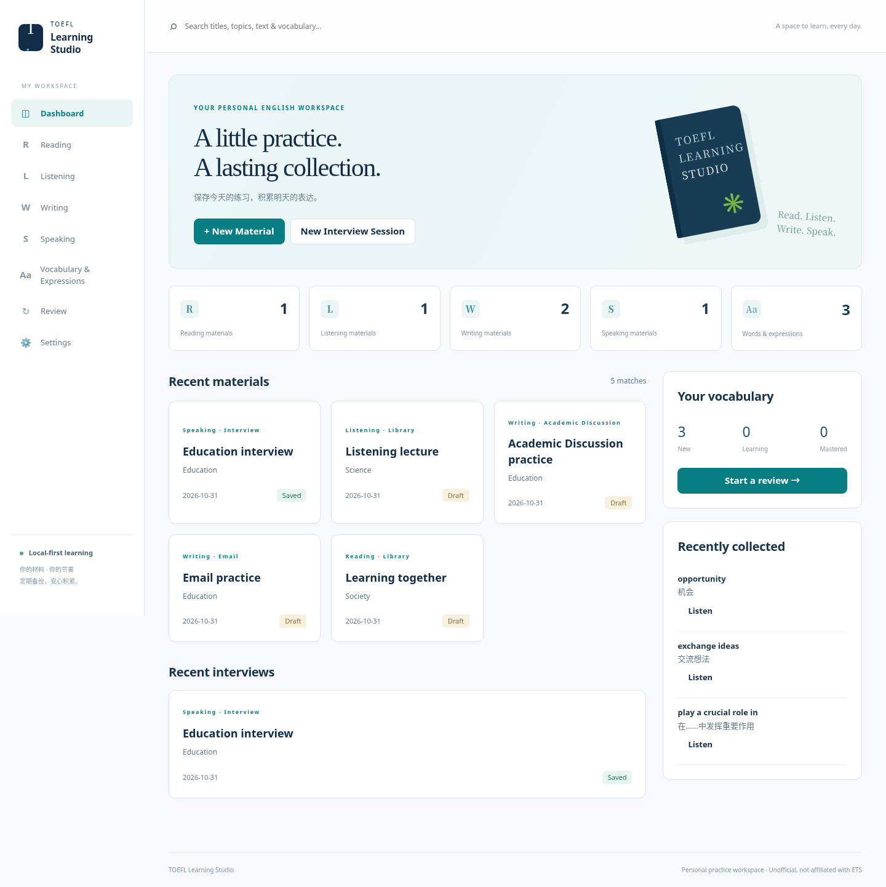

# TOEFL Learning Studio

A personal, local-first TOEFL practice workspace, built from [Textusound](https://github.com/zhouhuijuan040917-ui/textusound). Reading, Listening, Writing, Speaking, Vocabulary & Expressions and Review share one IndexedDB database and the original Kokoro TTS worker. No account, backend or paid AI API is required.



## 使用方法

1. 在 Reading / Listening / Writing / Speaking 点击 **New Material / New Interview Session**，填写日期、Topic 和标题。支持保存未完成的 **Draft**。日期默认使用浏览器本地当天日期。
2. Speaking 每组固定四道题，每题可以添加多篇 **Sample Answer / My Answer**。Writing 支持 Email 和 Academic Discussion，并允许多篇回答。Reading 保存文章与备注；Listening 上传音频并粘贴 Transcript。
3. 在正文中选中单词、短语或句子，点击右侧 **Add selected text**，填写中文释义。自动保留来源科目、材料、题目/回答和例句；正文中标记已收录词句。全局词汇条目可跳回来源。也可用 **Add / bulk import** 输入 `word - 中文释义`，一行一个。Vocabulary 与 Expressions 分开分类，同类型词条忽略大小写和多余空格去重，保留多个来源例句。
4. 选择美式/英式、男女声线和语速，点击 **Generate / Play**。首次需下载 Kokoro 模型，CPU/WASM 合成可能较慢；进度面板可取消。生成结果自动保存在本浏览器的材料或词条下。已有同文本/声线/语速音频直接播放，不重新生成。**Sentence practice** 和选区朗读支持逐句跟读。
5. 音频卡支持播放/暂停、进度拖动、Replay、Loop、播放速度和 **Download WAV**。**Save as…** 可调用 Chrome/Edge 的文件保存选择器；不可用或写入失败时使用下载回退。原始听力录音标记为 **Original Audio**，合成录音标记为 **Generated TTS**。可以保留多个声线和语速版本。正文修改后旧音频仍保留并显示过期提示。
6. 在 **Review** 按科目、Topic、收录日期和掌握状态筛选。提供英文回忆中文、中文回忆英文、听发音回忆、例句挖空四种模式，翻卡并标记 New / Learning / Mastered，支持循环复习。
7. 顶部搜索覆盖全部科目的标题、Topic、英文正文和全局词汇；各资料库支持日期、主题、状态筛选，Writing 支持类型筛选。修改 Topic 即可把材料移入其他主题分类。
8. **Settings → Export backup** 定期导出 JSON，勾选音频会包含原始录音和所有生成音频。**Restore backup 会替换整个学习库**，请先导出当前数据；导入前检查格式与来源关联，全部写入同一事务。导入上限为 100 MB，音频 Base64 编码会增加约三分之一体积。音频较多时需及时整理、拆分使用或在以后扩展流式备份。

## 数据在哪里？

材料、词条、来源、掌握状态和音频 Blob 保存在当前网站域名下的浏览器 **IndexedDB**，不上传到 GitHub 或其他服务。模型资源由浏览器缓存。正文、音频不会发送给模型服务器。其他设备、其他浏览器、其他域名和隐私窗口不会自动拥有这些数据。清除浏览器站点数据会丢失资料；不要把本地存储当作唯一备份。

Settings 显示站点容量估算，并可请求浏览器持久存储。浏览器可能不批准该请求，容量也因设备而异。配额不足会提示保存失败。删除材料会删除其音频并移除词汇的该来源，全局词条及其他来源仍保留；删除回答同样清理其音频与来源。修改文本不删除旧音频。备份含个人学习数据，应妥善保存。

旧 Textusound 没有持久化材料或音频，所以无旧资料库可迁移。旧版保存目录使用原有独立数据库保留；原始播放器源码仍保留供参考，新入口是 `src/studio.js`。

## Develop

Requires Node.js 20+ and npm. CI uses Node 20; development was also checked on Node 24. Chromium is needed for browser tests.

```bash
# Browser-only app does not need the Node CUDA execution provider.
ONNXRUNTIME_NODE_INSTALL_CUDA=skip npm ci
npm run dev
npm test
npm run build
CHROME_PATH=/usr/bin/chromium npm run test:browser
CHROME_PATH=/usr/bin/chromium npm run test:restart
# Optional, network + CPU intensive: real Kokoro downloads and generation, no mocks.
RUN_TTS=1 CHROME_PATH=/usr/bin/chromium npm run test:browser
npm run preview
```

The restart suite uses the preceding browser suite’s synthetic backup, imports it into a disposable persistent profile, fully closes and restarts Chromium, then checks saved audio without model requests.

The browser suite serves the built application beneath `/textusound/` and validates IndexedDB, four-question interviews, multiple answers, selection capture, vocabulary deduplication, uploads, actual media playback progress, review, deletion, backup restore and mobile layout. `RUN_TTS=1` additionally synthesizes all four interview questions and first answers plus an expression and word, tests cache reuse, WAV download, a new browser tab and audio version warnings. Headless media tests validate decoder state and advancing playback, not human-perceived pronunciation quality. Tests create isolated browser contexts and do not touch your own learning library.

`CHROME_PATH` can point to installed Google Chrome or Chromium; otherwise the suite looks at `/usr/bin/chromium` and `/usr/bin/google-chrome`. Install the browser separately if neither exists. This project does not install a browser or GPU automatically. Browser-test screenshots/results are written to `/tmp/toefl-studio-test` or `TEST_ARTIFACT_DIR`.

## GitHub Pages

The existing `.github/workflows/deploy.yml` now tests and builds pull requests; merging into `main` builds and deploys through GitHub Pages. One-time repository setting: **Settings → Pages → Source: GitHub Actions**. The user must merge the reviewed PR to update the live site.

Intended URL: `https://zhouhuijuan040917-ui.github.io/textusound/`.

Vite retains `base: "./"`; navigation uses hash routes, e.g. `/textusound/#Speaking`, and model workers/assets use relative URLs. Pages has no backend and does not synchronize your learning data. Browser origin storage is shared across the same origin, independent of the project subpath; use backups when moving deployments. Publishing a Codex cloud environment does not deploy the website.

## Network and browser checks

The app fetches public resources from `huggingface.co`, its subdomains and `*.hf.co` / `*.xethub.hf.co`, plus `cdn.jsdelivr.net`. The quantized model tested here redirected to **`us.aws.cdn.hf.co`**. Signed CDN URLs are temporary: allow the hostname rather than copying query strings. No Google Fonts request is necessary in the new interface; it uses system fonts.

The original worker supports WebGPU with a WASM fallback. Chrome/Edge are recommended for local saving; other browsers can use WAV downloads. A supported browser and HTTPS (or localhost) are needed for secure-context APIs. No service worker/offline-first installation is provided: keep the page assets and first-time model download available.

For a manual Chrome/Edge acceptance check:

1. Open the deployed page, open DevTools → Network, keep errors visible, and create a four-question Interview Session with short English questions and answers.
2. Generate each question and answer. Wait for progress to complete; click Play and listen for the correct text, voice and speed. Try pause, seek, replay and loop. First use may take several minutes on CPU.
3. Add `opportunity - 机会` to Vocabulary; generate its pronunciation independently. Change to a British voice and 0.8× speed to create a separate version.
4. Download the WAV and open it in a local player. Use Save as… to choose a folder and allow the native browser permission. Cancel once and confirm saved in-app audio remains available.
5. Close the tab; reopen the same site in the same browser profile. Open the saved material and play its audio without generating again. Edit its text and confirm the old-version warning.
6. Upload an MP3/WAV in Listening, save and reopen it. Confirm original audio and TTS labels remain distinct. Select an expression in Reading or Writing and check its source in the global bank.
7. Export a backup **with audio**. Restore into a separate browser profile, then verify text, vocabulary links, mastery and audio playback. Do not replace an existing library without first backing it up.
8. If generation fails, record the failed request's **hostname, path, status/error and Console error**. A CSP error differs from a proxy 403 or TLS failure. Never disable TLS or integrity checks to make a download pass.

See [validation report](docs/validation.md) for executed checks and limitations. This is an unofficial personal study tool; it is not affiliated with ETS. It does not automatically generate exam questions, score speech, transcribe recordings, or sync devices.

## License

Application code: CC0-1.0. Kokoro/Transformers.js: Apache-2.0; model: Apache-2.0. Third-party components retain their own licenses. No paid API or copyleft audio encoder is introduced.
